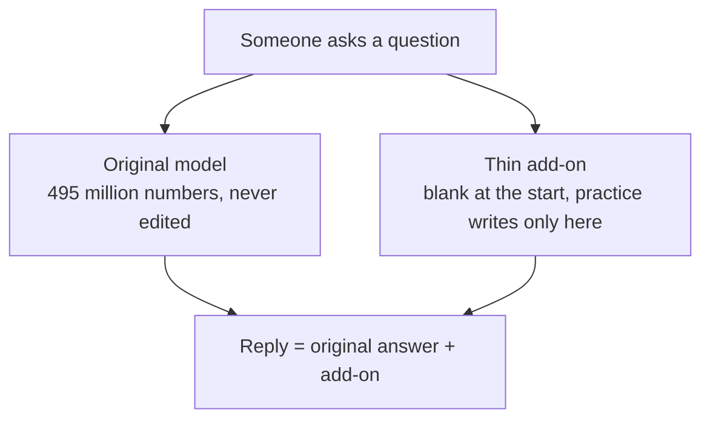
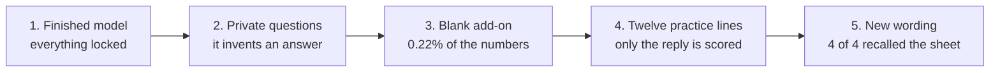

# LoRA on a real language model

A frozen copy of [Qwen2.5-0.5B-Instruct](https://huggingface.co/Qwen/Qwen2.5-0.5B-Instruct) learns a four-line on-call sheet. The original weights stay locked. A small add-on (LoRA) is the only thing training is allowed to change.

On the recorded run, four questions the model had never practiced came back with the sheet. Two ordinary questions (`2 + 2`, capital of France) got worse. That leak is part of the result, not a footnote.

## What is in this folder

| File | What it is |
|---|---|
| `lora_tutorial_and_implementation.ipynb` | Tutorial from the math through a toy network, then the real model in section 8. Section 8 already contains the printed before/after from the run. |
| `lora_real_llm_demo.py` | The script section 8 executes. Loads the model, prints baseline answers, trains the add-on, prints the same questions again. |
| `lora_real_llm_documentation.md` | Step-by-step account of that script, including the three places the behavior actually changes. |

## How a reply is produced

The question takes two paths. Their results are added.



Before practice the add-on contributes nothing, so the reply matches the original model. After practice the reply is the original answer plus the on-call sheet. The same addition is why an unrelated question can get pulled toward the sheet.

## What the run did



Steps 3 and 4 are the only places anything was written.

Recorded on an Apple M2, 6 Nov 2026, about 77 seconds of training once the weights were cached:

| | |
|---|---|
| Trainable parameters | 1,081,344 of 495,114,112 (0.22%) |
| Practice set | 12 handwritten question/answer pairs, 4 facts |
| Checkpoint kept | round 7 of 8 |
| Held-out on-call questions | 4 of 4 contained the right fact |
| `2 + 2` and capital of France | both drifted |

## Run it

From this folder, with PyTorch, Transformers, PEFT, and Accelerate installed:

```bash
pip install -r requirements.txt
PYTHONUNBUFFERED=1 python3 lora_real_llm_demo.py
```

The first run downloads about 1 GB from Hugging Face. Later runs use the local cache.

To repeat it from the notebook, open `lora_tutorial_and_implementation.ipynb` with this folder as the working directory and run section 8. The cell loads `lora_real_llm_demo.py` from the current directory.

Tested with Python 3.10, PyTorch 2.8.0, Transformers 4.46.3, PEFT 0.21.2, Accelerate 1.15.0, on Apple MPS. CPU works. A CUDA GPU works if one is present. The script picks MPS, then CUDA, then CPU.

This adapter memorizes a twelve-line sheet. It is not a general fine-tune, and it should not be the default model for other questions.
